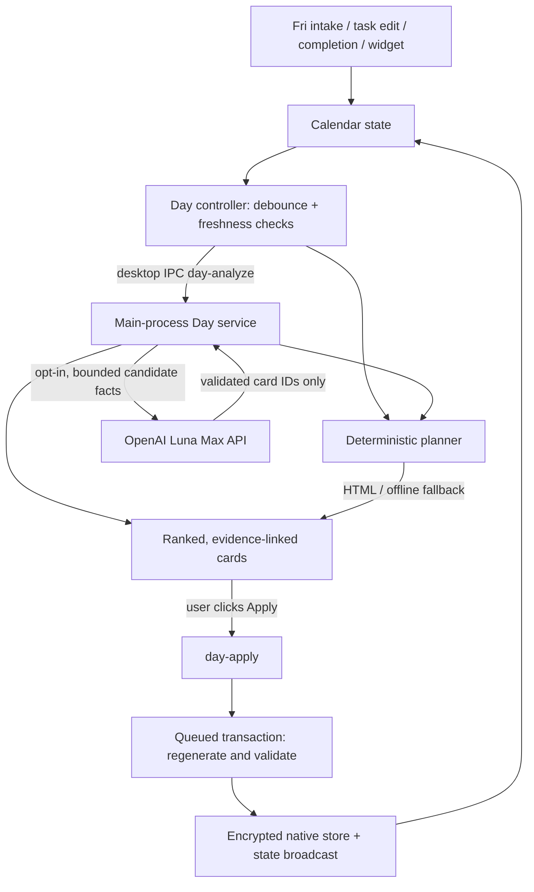

# Day — proactive calendar assistant (experiment)

Branch: `experiment/day-openai-luna`. This is an implementation for testing, not a deployed contest submission.

## Selected behavior

The user selected these features on 23 November 2026:

- Detect overlapping appointments and propose moving flexible work. Apply only when the user clicks.
- Remind deadlines approaching within 24 hours. Do not estimate effort, break down work, or schedule deadline preparation.
- Show a count on Day and a panel of suggestions. No new operating-system notifications.
- Focus sessions created by Fri are flexible. Other local tasks require the “Có thể dời” checkbox. Imported appointments remain fixed.
- No meeting preparation suggestions in this iteration.

Existing Fri calendar data is the input. There is no prompt box or second calendar-entry workflow. Changes in saved/imported tasks, task completion, native widget updates, app startup, return to the app, and minute boundaries refresh the suggestions. The native app must be running. Fri still requires its existing source intake/review process; Day does not claim continuous synchronization with every source application.

## Run and configure

Requires Node 24 and the repository's desktop prerequisites. On first setup:

```powershell
npm --prefix preview ci
npm --prefix desktop ci
Copy-Item desktop/.env.day.example desktop/.env.day # only if .env.day does not exist
```

Fill `OPENAI_API_KEY=` in **desktop/.env.day**. Leave `DAY_MODEL=gpt-6-luna` and `DAY_REASONING_EFFORT=max`. The local file is ignored by Git and explicitly excluded from packaging; never paste a real key in source, chat, screenshots or a browser bundle. Environment variables with these names override file settings. The configuration parser accepts assignments only and does not execute shell syntax.

```powershell
node start-day.cjs
```

To test the key/model with exactly one API request using synthetic calendar facts (not your calendar), run `node check-day.cjs`. This consumes API tokens. The script prints only success/model/timing metadata or a generic failure.

Open Day → “Cách Day hoạt động” → enable “Dùng OpenAI Luna Max để sắp thứ tự gợi ý”. This provider-specific consent (`settings.dayOpenAIEnabled`) is off by default. No restart is needed after editing the key; main reads configuration before requests. The panel reports local fallback if configuration is missing or the API fails. A packaged app reads `day.env` inside Electron's `app.getPath('userData')` directory (normally `%APPDATA%/FRI` on Windows), not a bundled key. For a shared production service, keys belong on the authenticated backend, not in a distributable client.

The standalone `FRI-liquid-glass.html` runs local detection and move proposals. OpenAI is available through the desktop main process; the HTML preview does not contain a public inference endpoint or API key.

## Architecture and ownership



| File | Responsibility |
|---|---|
| `preview/intake.js` | Existing input review; mark imported tasks fixed and Focus sessions flexible with their finish limit |
| `preview/app.js` | Notify Day on changes, preserve task provenance when editing, provide explicit flexibility control |
| `preview/day.js` | Automatic triggers, badges, evidence links, dismissal, consent, UI freshness, apply |
| `desktop/day-core.cjs` | Shared pure planner, canonical cards, snapshot fingerprint, action revalidation |
| `desktop/day-provider.cjs` | Config parser and bounded OpenAI adapter; no Electron or UI dependency |
| `desktop/day-service.cjs` | Authoritative state read, opt-in, cache, request limits, in-flight deduplication, fallback |
| `desktop/store.cjs` | Atomic serialized encrypted transaction; reject stale apply after another edit |
| `desktop/services.cjs` | Wire the three Day service actions into the existing trusted IPC boundary |
| `preview/build.mjs` | Bundle the same planner and UI into web/desktop artifacts |

No general agent framework is needed for two tools with deterministic outcomes. This is a constrained event-driven assistant with a provider adapter, a policy layer, executable action validation and a user decision step. It cannot run arbitrary tools, send messages, visit model-generated URLs, or write changes to external calendars.

### Internal API contract

The renderer uses the existing `friDesktop.service(action, input)` bridge. Electron validates the main window and frame; the renderer continues to have no direct HTTP/HTTPS access.

| Action | Input | Output |
|---|---|---|
| `day-status` | none | `{configured, model, reasoningEffort, cloudEnabled}` — never the key |
| `day-analyze` | none; ignores renderer calendar claims | `{cards, fingerprint, mode, status}` |
| `day-apply` | `{id, fingerprint}` | persisted `{state, revision}` or stale/invalid error |

A card contains `{id,type,title,body,evidenceIds,priority,at,move?}`. A move is `{taskId,date,time,fromDate,fromTime}`. Sending a different move from the renderer does not change what is applied: the transaction regenerates the canonical proposal from current state. Repeating an applied request fails freshness validation. The store's regular field-merging save path remains available for existing app/widgets; Day actions use the separate serialized transaction.

Additional task fields are backward compatible: `flexible: boolean`, `imported: boolean`, `planningOrigin: 'focus'`, `flexibleUntil: 'HH:mm'`. An imported task's source fields survive edits.

### Planning policy

- Consider today and the next six local calendar dates, excluding completed or invalid items.
- Detect actual interval overlaps. Deadlines are points, never busy blocks or movable tasks.
- Propose a same-day contiguous slot between 09:00 and 18:00, preserving duration and respecting `flexibleUntil`. Do not move an already-started task.
- Exclude imported, fixed and all-day tasks from movement; ambiguous all-day occupancy suppresses move proposals.
- Evaluate the entire known day's busy intervals, then recheck at apply time. All suggestions refer only to data Fri knows; missing external appointments, travel requirements and preferences remain unknown.
- Keep at most eight cards. Dismissal is stored locally, capped at 100 IDs; changed conflict facts create a fresh card. “Hiện lại gợi ý đã bỏ qua” restores dismissed cards.
- HTML uses localStorage and a latest-state check. It does not provide the native store's cross-process transaction guarantees; use desktop for concurrency-sensitive testing.

### OpenAI's actual role

`POST https://api.openai.com/v1/responses`, model `gpt-6-luna`, `reasoning: {effort: "max"}`, `store: false`, strict JSON schema under `text.format`, and `max_output_tokens: 8192` (including reasoning). No tools or conversation state are enabled. Current official docs: [GPT-6 Luna](https://developers.openai.com/api/docs/models/gpt-6-luna), [reasoning](https://developers.openai.com/api/docs/guides/reasoning), [structured outputs](https://developers.openai.com/api/docs/guides/structured-outputs).

The model orders supplied cards by usefulness within deterministic urgency tiers. It receives small candidate summaries containing titles/times, not the full calendar, notes, locations, raw source text, images or credentials. Calendar text is untrusted data. Output must contain exactly the known card IDs, each once. Unknown IDs, extra keys, duplicate IDs, empty content and truncated responses fall back locally.

**This iteration does not claim that the LLM generates the schedule or improves it empirically.** Conflict detection and deadline reminders are deterministic. AI ranking is an experiment, and its incremental benefit must be evaluated before presenting AI as the core contest differentiator. The selected feature scope intentionally excludes effort estimation and meeting preparation.

Reliability limits: 800 ms UI debounce, 45-second provider timeout, 14 KB request ceiling, 64 KB response ceiling, no automatic retry, one in-flight call, 60-second request cooldown, 15-minute cache with at most 20 entries, and 30 attempts per UTC day **per running app session**. Restarting resets that budget; it is not a billing cap. Provider errors are not logged or exposed with their bodies. Late responses are discarded if the snapshot or consent changes. Turning off consent prevents future requests; it cannot retract an already-sent request.

## Verification and next release gate

```powershell
npm --prefix tests ci
node tests/node_modules/playwright/cli.js install chromium
node preview/build.mjs
node desktop/prepare.cjs
node --test preview/preview.test.cjs preview/intake.test.cjs preview/day.test.cjs
node --test --test-concurrency=1 desktop/core.test.cjs desktop/day.test.cjs desktop/day.integration.test.cjs desktop/planning.test.cjs desktop/brand.test.cjs desktop/desktop.test.cjs
```

Unit tests cover fixed/imported tasks, valid slots, Focus constraints, stale and forged actions, atomic writes, provider schema failures, timeout, consent revocation, cache and budget. Browser/native tests cover automatic display, applying a move, provenance retention, persistence and responsive layout. Provider tests use mocked responses and synthetic calendars. A live OpenAI call requires a configured key and explicit cloud enablement; automated tests do not demonstrate model quality.

Before a contest release: measure real usefulness versus local ranking on consented or synthetic Vietnamese calendars; test the actual key/model; add a hosted authenticated API if online AI trial is required; enforce a server-side usage budget and retention policy there. No AWS resource has been provisioned and no hosted AI endpoint is deployed by this branch.

### Verified on 23 November 2026

- Preview suite: 13/13 passed. Final rebuilt Day browser tests: 4/4 passed.
- Desktop suite: 50/51 passed, including Day provider/policy tests and native Day IPC/apply/restart integration. The existing widget resize test failed `635 !== 632`; the same failure reproduced on clean `origin/main` at `54584c6`, isolated at `D:\ChatGPT\momo\.baseline-fri-day`. It remains outside this change.
- The generated standalone app contains the current shared Day core; desktop CSP assets were regenerated. The key file is ignored.
- After the user saved the OpenAI key, `node check-day.cjs` made one real Responses API request with synthetic cards using `gpt-6-luna` and `reasoning.effort: max`. The structured output passed validation in 6,892 ms. No personal calendar was sent. This verifies connectivity and output format, not recommendation quality or production reliability.
