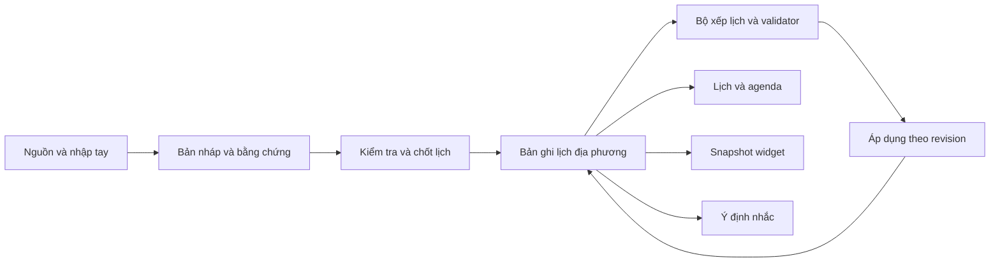

# Fri · Kiến trúc và công nghệ

Tài liệu kỹ thuật của Fri, cập nhật ngày 22/11/2026. Cột **Có trong Web** ghi hành vi có mã trong repository. **Đã chốt** ghi yêu cầu sản phẩm hoặc ràng buộc của bản bàn giao. **Đề xuất** ghi công nghệ hoặc thiết kế cần kiểm chứng ở mốc triển khai tương ứng. Kết quả chạy kiểm thử nằm trong [README](../README.md).

## Phạm vi và stack

Fri là lịch cá nhân local-first cho người gom lịch hẹn, hạn nộp và việc linh hoạt từ nhiều nguồn. Trình duyệt tiếp nhận ảnh, tệp ICS, nội dung dán và liên kết công khai, giữ bản nháp để duyệt rồi xếp việc vào khung giờ đủ điều kiện. Đích gần là dùng được lịch địa phương khi mất mạng. Đồng bộ, kết nối tài khoản và nhắc hệ điều hành đi sau.

| Lớp | Có trong Web | Hướng triển khai |
|---|---|---|
| Giao diện | Một `index.html` tự chứa, HTML/CSS/JavaScript thuần, biểu tượng inline và ảnh minh họa nhúng. Giao diện tiếng Anh mở ở Day, có Month và Year, nguồn, duyệt, widget và cài đặt. | **Đã chốt** giữ bản mô phỏng một tệp. **Đề xuất** khi cần duy trì nhiều client, tách mã TypeScript và asset trong source, dùng Vite/Rollup hoặc esbuild để tái tạo bản HTML một tệp có thể mở trực tiếp. Chọn một bundler sau khi kiểm tra bản sinh mở được từ `file://`. |
| Thiết kế | Beige · Rosewood mặc định, nền beige, chữ nâu đen, điểm nhấn `#955251`. Dùng font hệ thống Apple khi có. Vật liệu kính kết hợp backdrop blur và nền SVG khúc xạ. Month, Year và widget dùng ô vuông bo tròn. | **Đã chốt** giữ cùng vai trò token, ưu tiên trạng thái đọc được khi giảm độ trong suốt hoặc giảm chuyển động. Shared token data xuất ra CSS, Swift và Kotlin khi mở rộng. [Apple HIG Materials](https://developer.apple.com/design/human-interface-guidelines/materials) · [Apple HIG Widgets](https://developer.apple.com/design/human-interface-guidelines/widgets) |
| Domain và planner | `FriDomain` là JavaScript thuần. Ngày và phút được tính riêng, khoảng nửa mở, bộ xếp lịch một ngày. Bộ kiểm thử lấy đoạn script để chạy độc lập UI. | **Đã chốt** giữ domain và validator xác định được từ input, dùng chung fixture. **Đề xuất** chuyển dần sang TypeScript với discriminated unions và kiểm tra schema ở biên. Dùng Web Worker khi profiling xác nhận thời gian tính ảnh hưởng UI. |
| Lưu trữ và offline | `localStorage` giữ dữ liệu lịch, nguồn và tuỳ chọn theo origin/profile trình duyệt. Tệp mở tại máy chạy trực tiếp. Với bản HTTP, các thao tác local vẫn chạy khi trang đã mở và mất mạng. | **Đã chốt** tách nháp hẹn khỏi dữ liệu lịch. **Đề xuất** IndexedDB cho Web, SQLite cho shell native. Bản Web phát hành ở origin HTTPS ổn định có thể thêm service worker và phiên bản cache. Bản HTML rời chạy trực tiếp. [IndexedDB](https://developer.mozilla.org/en-US/docs/Web/API/IndexedDB_API) · [SQLite transactions](https://www.sqlite.org/lang_transaction.html) |
| Thu thập nguồn | Ảnh thật có preview và nhập tay. Bộ dữ liệu ảnh mẫu dùng văn bản dựng sẵn. Adapter đọc ICS, trường sự kiện JSON-LD và văn bản theo quy tắc. | **Đề xuất** OCR trên thiết bị và adapter nguồn theo capability. Dùng Apple Vision cho Apple, ML Kit Text Recognition cho Android sau khi đo ảnh tiếng Việt. Hỏi quyền riêng khi bổ sung xử lý từ xa. [Apple Vision](https://developer.apple.com/documentation/vision/recognizing-text-in-images) · [ML Kit Text Recognition](https://developers.google.com/ml-kit/vision/text-recognition/v2/languages) |
| Nhập hẹn | Nhập tên trước, ghi chi tiết đã biết, thêm hẹn tiếp hoặc chuyển sang thẻ bổ sung từng trường. Nháp được giữ khi đóng và mở lại. | **Đã chốt** chỉ cập nhật lịch khi tất cả hẹn trong đợt đã đủ thông tin và qua validator. |
| Widget và nhắc | Widget Web dùng lịch cùng revision. Mặt vuông hiển thị tiến độ và việc tiếp theo. Chọn widget để mở chồng thẻ việc sắp tới. Có bản xem trước màn hình khóa. Nhắc là intent để xem thử. | **Đã chốt** tách snapshot widget khỏi kênh đặt nhắc. **Đề xuất** WidgetKit, Jetpack Glance, Windows App SDK và dịch vụ notification riêng phù hợp nền tảng. [WidgetKit](https://developer.apple.com/documentation/widgetkit/) · [Jetpack Glance](https://developer.android.com/develop/ui/compose/glance) · [Windows widget providers](https://learn.microsoft.com/en-us/windows/apps/develop/widgets/widget-providers) |
| Backend và định danh | Lịch thuộc profile trình duyệt đang mở. | **Đã chốt** luồng lịch cơ bản dùng được dưới dạng khách local. **Đề xuất** bổ sung relay HTTP khi có đồng bộ opt-in hoặc connector cần thực thi phía server. Ưu tiên Node.js/TypeScript, Fastify và PostgreSQL để dùng chung schema, lưu giao dịch và kiểm tra phạm vi dữ liệu. [Fastify](https://fastify.dev/docs/latest/) · [PostgreSQL row-level security](https://www.postgresql.org/docs/current/ddl-rowsecurity.html) |
| Kiểm thử và phát hành | `node:test`, Playwright `1.64.1`, axe-core adapter Playwright `4.14.0` trong [`tests/package.json`](../tests/package.json). [GitHub Actions](../.github/workflows/web.yml) chạy kiểm thử logic, Chromium và WebKit. Không cần Node để mở app. | **Đề xuất** kiểm tra package Web trước phát hành. Thêm job ký native và kiểm thử thiết bị theo từng target. |

## Luồng dữ liệu và ranh giới



- **Thu thập** chuyển các nguồn độc lập thành bản nháp có bằng chứng. Trong Web, tải URL có giới hạn 1 MB và timeout 8 giây, không gửi credentials và không theo chuyển hướng. URL bị CORS, cần đăng nhập hoặc mất mạng có đường dùng tệp, ảnh hoặc dán nội dung. Với ảnh thật, preview thu nhỏ được tạo trên trình duyệt. URL, hình ảnh và dữ liệu trích là dữ liệu đầu vào. Adapter trả đề xuất qua schema domain.
- **Duyệt** giữ giá trị nguồn, dữ liệu người dùng điền và dữ liệu đã chốt. Danh tính ứng viên kết hợp ID nguồn với khóa mục. ICS có UID/occurrence và độ mới `SEQUENCE` khi nguồn cung cấp. Retry giữ ID ổn định và render diff khi dữ kiện đổi. Một nguồn lỗi hoặc một mục vắng khỏi phản hồi mới giữ nguyên lịch người dùng đã chốt. Tín hiệu hủy lịch rõ ràng đi qua bước duyệt. [iCalendar RFC 5545](https://datatracker.ietf.org/doc/html/rfc5545)
- **Domain** giữ kiểu mục, ngày giờ, vị trí, lịch lồng và quyền sửa. `fixed`, `task`, `deadline`, `context`, `child` và `trip` có trường riêng. Sự kiện nguồn ngày-only sống như ngày lịch. Giờ floating cần xác nhận múi giờ. Thời điểm có đủ dữ kiện dùng instant UTC cùng TZID gốc nếu có. Web hiển thị giờ Việt Nam. Dữ liệu gặp DST mơ hồ hoặc thiếu giờ kết thúc đi qua bản nháp.
- **Planner** nhận lịch đã chốt và cấu hình. Một lần chạy Web tìm một khung liền trong một ngày, ưu tiên khoảng ít dư trước hạn, giữ nghỉ và khóa. Khung có mặt là ràng buộc vị trí, lịch cố định chiếm chú ý, deadline là mốc. Hoạt động con cần đúng occurrence cha và đủ khung cùng vị trí. Chuyến đi giữ khoảng từ `arriveBy − duration − buffer` tới `arriveBy`. Hai lịch đã tồn tại có thể trùng và được gắn cờ. Khi có 150 phút hợp lệ cho việc cần 240 phút, lý do có thể nêu thiếu ít nhất 90 phút trong phạm vi đã tính.
- **Áp dụng** đọc revision gần nhất và kiểm tra lại phiên trước khi ghi. Lịch, widget và intent nhắc dùng cùng revision. Web xuất ICS từ phiên làm việc do Fri xếp sau kiểm tra lại xung đột. Lịch hẹn đưa vào qua nhập tay nằm trong lịch Fri. Xuất hoặc ghi đồng thời sang lịch ngoài cần hợp đồng riêng về chọn mục, đích và quyền.
- **Clients** hiển thị cùng dữ kiện từ `WorkItem` và snapshot. Web dùng đường dẫn nội bộ tới ngày hoặc đích theo ID. Đề xuất cho native là schema JSON có phiên bản và lớp điều hướng tra lại thực thể khi mở deep link, về agenda theo ngày khi mục đã mất.

### Hợp đồng miền cần tách khi mở rộng

| Bản ghi | Trường và bất biến |
|---|---|
| `SourceArtifact` | `sourceId`, loại adapter, fingerprint, trạng thái, revision và lần đọc. Tệp gốc hoặc preview có TTL/xóa riêng theo chính sách lưu. |
| `Candidate` / `Evidence` | `sourceKey`, version, kiểu mục, giá trị nguồn, bản sửa, trường chưa biết và trích đoạn hoặc vùng ảnh. Bản nháp chỉ trở thành dữ kiện lịch qua hành động xác nhận. |
| `AppointmentBatch` / `AppointmentDraft` | ID đợt và mục ổn định, thứ tự theo lúc nhập, pha nhập hoặc hỏi tiếp và câu trả lời đã ghi. Commit cả đợt khi mọi mục qua validator. Nếu mở rộng sang nhiều tab/thiết bị, mỗi thao tác có `commandId` và `expectedRevision`. |
| `WorkItem` | ID nội bộ, kiểu, tiêu đề, ngày hoặc mốc, dữ kiện theo kiểu và dấu vết xác nhận. Bản ghi con liên kết ID occurrence cha. Lưu timezone nguồn riêng với thời gian trình bày. |
| `PlanRevision` / `PlanBlock` | Revision đầu vào, revision kết quả, ID khung, `[start, end)`, giờ khóa và reason codes. Commit dùng compare-and-set trong transaction ở kho có giao dịch. |
| `WidgetSnapshot` | `schemaVersion`, `revision`, ngày, zone, `generatedAt`, `validUntil`, mốc đi, việc kế tiếp, tiến độ và khóa điều hướng. Khi hết hạn, hiện nhãn cũ và đường mở app. |
| `ReminderIntent` | ID ổn định theo occurrence và loại nhắc, thời điểm, revision, mức riêng tư và trạng thái adapter. Bản mới thay intent cũ với cùng ID. Trạng thái yêu cầu, hệ điều hành chấp nhận và thu hồi được đối soát riêng. |

Ví dụ chữ ký giao tiếp trong mã TypeScript đề xuất. Clock, lưu trữ và lớp native đi vào qua cổng phụ thuộc để test có thể chạy độc lập.

```ts
type Commit<T> =
  | { ok: true; revision: number; value: T }
  | { ok: false; reason: 'stale' | 'incomplete' | 'invalid' | 'storage'; fields?: string[] };

interface CalendarStore {
  read(): Promise<CalendarState>;
  commit(command: CalendarCommand, expectedRevision: number): Promise<Commit<CalendarState>>;
}

interface PublicationAdapter {
  replaceWidget(snapshot: WidgetSnapshot): Promise<void>;
  reconcileReminders(revision: number, intents: ReminderIntent[]): Promise<void>;
}

function proposePlan(state: CalendarState, date: string, rules: PlanRules): PlanProposal;
function validatePlan(state: CalendarState, proposal: PlanProposal): ValidationResult;
```

## Luồng thêm nhiều cuộc hẹn

**Đã chốt.** `Add appointment` mở chỗ nhập tên. Người dùng có thể ghi thêm chi tiết đã biết rồi bấm `New appointment` để nhập mục tiếp theo. `Done` kết thúc nhập. Fri xếp các trường còn thiếu thành một hàng đợi theo thứ tự hẹn, hiện một câu hỏi trên một thẻ, giữ câu trả lời khi chuyển câu và bỏ qua các mục đã đủ dữ kiện. Lịch chỉ nhận cả đợt sau khi mọi mục đủ dữ kiện và qua kiểm tra. Sau khi lưu, Fri mở lịch ngày của hẹn đầu tiên trong đợt.

Một cuộc hẹn theo giờ cần tên, ngày, giờ bắt đầu và giờ kết thúc. Địa điểm và ghi chú có thể bỏ trống. Khi giờ kết thúc sớm hơn giờ bắt đầu, người dùng có thể sửa giờ hoặc xác nhận hẹn qua đêm. Câu trả lời hợp lệ giữ nguyên nếu người dùng quay lại sửa một mục khác. Khi hủy đợt chưa xác nhận, các cuộc hẹn đã có trên lịch giữ nguyên.

**Lưu nháp Web.** Dữ liệu lịch nằm ở khóa `fri-web-v1`, dữ liệu hẹn đang nhập ở `fri-appointment-draft-v1`. Đợt nhập và từng hẹn có ID ổn định. Sau khi xác minh đủ trường, Fri ghi các hẹn cố định và ID đợt trong một lần lưu lịch, tăng revision một lượt, rồi xóa nháp. Nếu tải lại giữa hai lần ghi, Fri nhận diện đợt đã lưu và dọn bản nháp còn sót. Nếu trình duyệt báo lỗi ghi lịch, Fri giữ nháp và cho thử lại. Hai khóa `localStorage` có vòng đời riêng. Transaction đầy đủ xuyên nháp, lịch và outbox thuộc bước IndexedDB/SQLite.

| Kiểm tra | Điều kiện đạt |
|---|---|
| Nhập nhanh | Chỉ điền tên có thể chuyển qua `Hẹn mới`. Có thể nhập thêm chi tiết trước khi chuyển. |
| Xử lý tuần tự | Sau `Xong` chỉ thấy câu hỏi hiện tại. Trường đã có được giữ. Một hẹn đã đủ thông tin không cần hiện câu hỏi thừa. |
| Xác nhận cả đợt | Lịch và widget giữ revision cũ trong lúc còn thiếu. Khi hoàn thành, số mục trên lịch tăng đúng bằng số hẹn hợp lệ trong đợt. |
| Dữ kiện sai hoặc mơ hồ | Ngăn commit một phần khi một hẹn thiếu ngày, thiếu giờ hoặc có giờ kết thúc không hợp lệ. Việc quay lại sửa giữ các câu trả lời trước đó. |
| Độ bền | Kiểm tra nút bấm nhanh, hủy trong lúc hỏi, mở lại bản nháp nếu được lưu, và revision cũ từ tab khác. Cùng đợt chỉ được áp dụng một lần. |
| Dễ dùng | Có thể hoàn thành bằng bàn phím và trên màn hình 360 px. Focus đi tới câu hỏi tiếp theo và trở về đúng ngữ cảnh khi đóng. |

Khi đã có dữ kiện, việc phát hiện hai hẹn trùng giờ và việc hẹn có đủ trường là hai kết quả riêng. Lịch có thể giữ hai hẹn cố định do người dùng chủ động thêm và gắn cờ theo luật domain. Scheduler vẫn tránh khoảng bận của chúng.

## Lưu trữ, offline và đồng bộ

**Hiện tại.** JSON local dùng theo origin, nên địa chỉ `file://`, `http://127.0.0.1:8000` và một Website đã phát hành có kho riêng. Chọn một origin ổn định khi dùng dữ liệu thật. Revision hiện có kiểm tra trường hợp cửa sổ xem trước cũ. `localStorage` và sự kiện tab cung cấp khả năng nhận biết thay đổi, với giao dịch nhiều bản ghi và điều phối ghi đồng thời thuộc bước IndexedDB/SQLite. Xóa dữ liệu trình duyệt hoặc vượt quota có thể làm mất dữ liệu chưa xuất.

**Đề xuất Web.** Kho IndexedDB đặt `schemaVersion` riêng với `revision`, một transaction lưu mục, draft, revision và outbox. Migrate JSON cũ theo cách lặp an toàn. Giữ JSON cũ đến khi đọc lại và kiểm tra số mục, danh tính nguồn, preference và revision thành công. `storage` event hoặc `BroadcastChannel` làm tín hiệu tải lại sau commit, dữ liệu bền nằm trong kho. Thêm bản sao export/import dạng JSON khi chuẩn bị phục hồi dữ liệu. Web phát hành HTTPS có service worker cache shell theo hash; adapter nguồn từ xa luôn hiển thị lỗi riêng khi mạng mất.

**Đề xuất native.** Dùng SQLite, foreign keys đã bật và migration có giao dịch. Ghi thay đổi, revision và outbox vào cùng transaction. File nguồn nằm trong thư mục app riêng; native widget đọc snapshot tối thiểu được thay nguyên khối. Kho hệ điều hành giữ token và khóa. Thử sao lưu và phục hồi sau khi nâng schema, đầy dung lượng, mất quyền và tiến trình bị dừng giữa chừng. [SQLite transactions](https://www.sqlite.org/lang_transaction.html)

**Đề xuất sync.** Mỗi thiết bị lưu trước tại máy. Nếu người dùng chọn đồng bộ, outbox gửi `operationId`, `deviceId`, revision gốc và thay đổi. API xác thực rồi chống lặp operation trước khi cấp sequence. Thiết bị nhận cập nhật theo cursor và chạy lại planner cục bộ khi nhận lịch mới. Với cùng một trường bị sửa trên hai thiết bị, giữ hai giá trị để người dùng chọn nếu ảnh hưởng lịch. Mốc xóa dùng tombstone trong thời hạn chính sách. Chọn thiết bị chủ để đặt nhắc khi dùng nhiều thiết bị, nhận trạng thái đổi chủ trước khi bật lại trên thiết bị mới.

### API và xác thực khi có server

| Hạng mục đề xuất | Thiết kế |
|---|---|
| Dịch vụ | Một monolith Fastify TypeScript sau HTTPS. Postgres cho account, membership, stream thay đổi và idempotency. Storage ảnh riêng chỉ khi người dùng chọn đồng bộ bằng chứng và đã định nghĩa thời hạn. Ưu tiên hàng đợi Postgres/outbox ở pilot khi đủ tải. [Fastify](https://fastify.dev/docs/latest/) |
| API | REST `/v1`. `POST /sync/operations` nhận batch thay đổi, `GET /sync/changes?cursor=…` trả trang theo scope. Tích hợp nguồn có endpoint riêng theo provider, capability, trạng thái và bước thu hồi. Contract test bao phủ cursor lỗi thời, schema mới, retry và quyền. |
| Danh tính | Web khách dùng thiết bị hoặc profile. Khi bật tài khoản, chọn OIDC/OAuth từ trình duyệt hệ thống, Authorization Code + PKCE cho native và callback xác minh `state`/`nonce`. Web giữ phiên qua cookie HttpOnly, Secure và SameSite phù hợp, có kiểm tra CSRF cho request ghi. Token connector tách khỏi phiên Fri. [OAuth 2.0 for Native Apps](https://datatracker.ietf.org/doc/html/rfc8252) |
| Tenant | Pilot bắt đầu mỗi tài khoản một không gian cá nhân. Nếu thêm không gian chung, server suy ra user từ phiên và kiểm tra membership/role rồi mới chọn `workspace_id`. Bảng lịch, source, outbox dùng khóa theo workspace, SQL dùng role hạn quyền và RLS. Kiểm tra quyền qua API và đường truy cập storage, gồm các trường hợp đọc/ghi chéo tenant. [Postgres row security](https://www.postgresql.org/docs/current/ddl-rowsecurity.html) |
| Bảo mật dữ liệu | Dùng TLS, lưu secret trong hệ quản lý khóa, cấu hình quyền tối thiểu cho provider, tách luồng xóa tài khoản và thu hồi connector. Log event kỹ thuật bằng mã lỗi và ID bất định; tránh ghi URL riêng, trích đoạn, tiêu đề và địa chỉ. Pilot chọn retention và quy trình xóa/restore trước khi lưu dữ liệu người dùng. |
| Mã hóa đầu cuối | Là lựa chọn riêng cho sync cá nhân nếu thiết kế được ghép thiết bị, phục hồi khóa và thu hồi. Qua pilot khi các trường hợp mất máy, reset khóa và thêm thiết bị đã có test. Connector cần đọc nội dung có consent và phạm vi dữ liệu riêng; ghi rõ giới hạn đối với chức năng đó. |

## Nguồn, OCR và dịch vụ tùy chọn

1. **ICS và văn bản** là đường cơ sở. Mở rộng parser qua recurrence, ngoại lệ, timezone tùy chỉnh và cặp start/end qua ngày. Giữ cảnh báo trực tiếp khi adapter chỉ hiểu các occurrence tường minh. Khi thử JSON-LD của một trang, dùng sự kiện mà trang công khai cho đọc với CORS. Nếu cần fetch phía server cho các nguồn đã định danh, giới hạn adapter, redirect, đích mạng, thời gian và kích thước. Giữ đường tải ICS và nhập tay. [RFC 5545](https://datatracker.ietf.org/doc/html/rfc5545) · [Schema.org Event](https://schema.org/Event)
2. **OCR** trả dòng, vùng bằng chứng, độ chắc chắn và tiền xử lý ảnh. Tập fixture cần ảnh bảng khác múi giờ, tiếng Việt có dấu, ảnh mờ, cột lệch và câu thiếu năm. Đo trường được nhận đúng trước khi dùng bản nháp làm mặc định. Parser quy tắc chạy trước. Nếu bổ sung LLM, đầu ra có schema và liên kết bằng chứng, được validator kiểm tra và vào cùng hàng đợi duyệt.
3. **Connector** nối lịch hoặc thư theo tài khoản và phạm vi do người dùng cấp. Google Calendar và Microsoft Graph là adapter riêng khi có pilot phù hợp. Gmail chỉ đọc trong mốc Fri Dot sau V1, đi qua diff và xác nhận. Retry chỉ lấy phần chưa nhận theo cursor và so version; khi mất quyền, hiển thị lần thành công gần nhất và giữ lịch đã xác nhận. [Google Calendar API](https://developers.google.com/workspace/calendar/api/guides/overview) · [Microsoft Graph calendar API](https://learn.microsoft.com/en-us/graph/api/resources/calendar?view=graph-rest-1.0)
4. **Di chuyển** dùng thời lượng và đệm người dùng xác nhận. Khi pilot routing, kiểm tra khu vực, phương tiện, attribution, thời hạn ETA và fallback offline trước khi chọn nhà cung cấp. ETA cũ cần timestamp, sửa ETA tạo revision và thay nhắc tương ứng. Google Routes là ứng viên khi đã kiểm chứng độ phủ đường xe máy cho nhóm pilot. [Google Routes coverage](https://developers.google.com/maps/documentation/routes/coverage-two-wheeled)

## Nền tảng, widget và phát hành

| Mốc | Stack đề xuất | Cổng kiểm chứng |
|---|---|---|
| Web desktop/mobile | HTML một tệp cho demo. TypeScript packages, IndexedDB và static hosting HTTPS cho bản dùng thực tế. HTML dùng DOM và CSS native. Khi component tăng phức tạp mới đánh giá đưa React vào shell Web. | Chạy trực tiếp HTML và HTTP. Test Chromium/WebKit, bàn phím, 360 px, Sáng/Tối, offline, login fallback, stale revision, batch hẹn và phục hồi dữ liệu. |
| Windows 11 | Tauri 2/Rust bọc UI Web, SQLite, tray và API hệ thống cho nhắc. Dùng Windows App SDK Widget provider / Adaptive Cards khi đăng ký được trong build đóng gói. | Kiểm tra Windows build cụ thể, quyền, MSIX/installer, ký, tray, sleep/wake, cập nhật, Widgets Board và đường mở app. [Tauri 2](https://v2.tauri.app/start/) · [Windows widget providers](https://learn.microsoft.com/en-us/windows/apps/develop/widgets/widget-providers) |
| Android | React Native + Expo development build, TypeScript dùng chung domain, SQLite. Kotlin/Glance cho AppWidget, dùng WorkManager hoặc AlarmManager theo loại tác vụ được quyền. | APK/AAB ký, đo hai kích thước widget, kiểm tra Pixel và một OEM khác, thiết bị sleep/kết thúc app, quyền và reboot. Điều kiện hiển thị màn hình khóa xác nhận trên OS/launcher cụ thể. [Expo development builds](https://docs.expo.dev/develop/development-builds/introduction/) · [Glance](https://developer.android.com/develop/ui/compose/glance) · [Android alarms](https://developer.android.com/develop/background-work/services/alarms) |
| macOS | Thử shell desktop Tauri kèm target SwiftUI/WidgetKit. Kiểm chứng App Group và signing, sau đó chọn giữ shell hay dùng SwiftUI/AppKit cho macOS. Adapter SQLite giữ cùng schema. | Gói đã ký và notarize khi phân phối ngoài Store, thử menu bar, widget desktop, deep link, lịch nền và quyền. Ghi rõ phiên bản macOS, máy Intel hoặc Apple Silicon đã thử. [Tauri 2](https://v2.tauri.app/start/) · [WidgetKit](https://developer.apple.com/documentation/widgetkit/) |
| iOS/iPadOS | React Native + Expo dev build với SwiftUI/WidgetKit extension và App Group. Nếu extension chia sẻ dữ liệu hoặc UX hệ thống khó duy trì trong shell, đánh giá SwiftUI cho app. Native dùng UserNotifications cho intent và WidgetKit timeline cho snapshot. | TestFlight trên thiết bị thật. Kiểm tra Widget Home small/medium, tint, Lock Screen, quyền riêng tư, deep link, app đóng, đổi/mở lại quyền nhắc và timeline stale. [WidgetKit refresh](https://developer.apple.com/documentation/widgetkit/keeping-a-widget-up-to-date) · [Apple local notifications](https://developer.apple.com/documentation/usernotifications/scheduling-a-notification-locally-from-your-app) |

Widget ưu tiên việc kế tiếp hoặc giờ rời đi cùng tiến độ đọc nhanh. Màn hình khóa mặc định chỉ có giờ/trạng thái chung. Snapshot ghi ngày hiện hành và hạn dùng để host báo cũ. Host quyết định thời điểm refresh và vận hành khi thiết bị ngủ. Nhắc lịch reconcile theo intent và revision, với đường hiển thị quyền hiện hành và đường quay về agenda. Các fixture dùng chung để so nội dung Web, Swift và Kotlin.

## Kiểm thử, CI và vận hành

Chạy từ thư mục gốc. Dùng Node 24 để lặp môi trường đã dùng phát triển, cài theo lockfile. Chạy shell PowerShell trên Windows hoặc dùng cú pháp biến môi trường tương ứng với shell đang dùng.

```powershell
npm ci --prefix tests
npm exec --prefix tests -- playwright install chromium webkit
npm test --prefix tests
$env:FRI_BROWSER = 'webkit'
npm run test:browser --prefix tests
Remove-Item Env:FRI_BROWSER
```

- **Verification Web.** [`tests/domain.test.cjs`](../tests/domain.test.cjs) chạy date-only, DST, thứ tự ICS, half-open, vị trí, hoạt động con, thời lượng di chuyển, khả năng trước hạn, revision và snapshot. [`tests/browser.test.cjs`](../tests/browser.test.cjs) chạy bằng browser engine thực, fixtures và máy chủ cục bộ. Kiểm tra kéo dài gồm retry nguồn lỗi, nhiều tab, bàn phím, giao diện nhỏ và theo palette. App hiện dùng fixture ngày thứ Hai 23/11/2026, `Asia/Ho_Chi_Minh`.
- **CI Web.** [Workflow](../.github/workflows/web.yml) chạy trên pull request, push lên `main` hoặc kích hoạt thủ công. Trên Ubuntu, dùng Node 24 và `npm ci`, chạy logic một lượt và browser test với Chromium và WebKit. Kiểm thử có ca mở HTML từ đĩa. Đề xuất bổ sung screenshot hoặc trace khi lỗi và phát hành báo cáo build cùng bản đóng gói. Native thêm runner theo OS, ký trong environment có quyền riêng, sau đó test thiết bị. [GitHub Actions cho Node.js](https://docs.github.com/en/actions/tutorials/build-and-test-code/nodejs)
- **Quan sát khi có backend.** Theo dõi tỉ lệ adapter lỗi theo loại, retry, lỗi parse/migration, stale commit, tuổi outbox, tuổi snapshot và kết quả nhận intent của OS. Dùng mã lỗi và dữ liệu mẫu trong test. Tập chuyển sang bản server trước phải giữ khả năng nhập tay khi dịch vụ lỗi. Chuẩn bị backup Postgres, thử phục hồi và rollback theo migration tương thích với client cũ.
- **Điều kiện công bố native.** Đính kèm build, host, OS, nhóm kiểm thử, kết quả cài, cập nhật, widget, mất mạng, sleep, quyền và riêng tư. Kết quả Chromium/WebKit desktop là kiểm chứng Web. Trình giả lập kiểm tra giao diện và luồng tích hợp, bản phát hành cần kiểm chứng thêm cơ chế host trên thiết bị.

## Trình tự triển khai

1. **Web hiện hành.** Giữ bản `index.html` và test truy cập trực tiếp. Chốt luồng thêm hẹn theo đợt và thuật ngữ tiếng Việt. Cập nhật README theo kiểm thử đã chạy.
2. **Lưu bền và hợp đồng.** Đưa schema TypeScript, validator và date model vào modules, giữ fixture cũ. Thêm IndexedDB, migration và export phục hồi. Web phát hành qua một origin HTTPS sau khi kiểm tra khả năng cập nhật offline.
3. **Native V1.** Windows và Android đi trước, tập trung SQLite, cập nhật/khôi phục, OCR và nhắc có kiểm chứng. Kế tiếp macOS và iOS với snapshot chung, signing, App Group và WidgetKit trên thiết bị thật.
4. **Tích hợp theo nhu cầu.** Mở từng adapter có pilot, trước khi ghép Google/Microsoft, đồng bộ đa thiết bị hoặc routing. Đo lỗi nguồn, độ chính xác dữ kiện, công suất planner và độ mới widget để chọn hạng mục tiếp theo. Bất kỳ lựa chọn vendor mới nào đều đi cùng kiểm thử và quyết định thay thế được.
